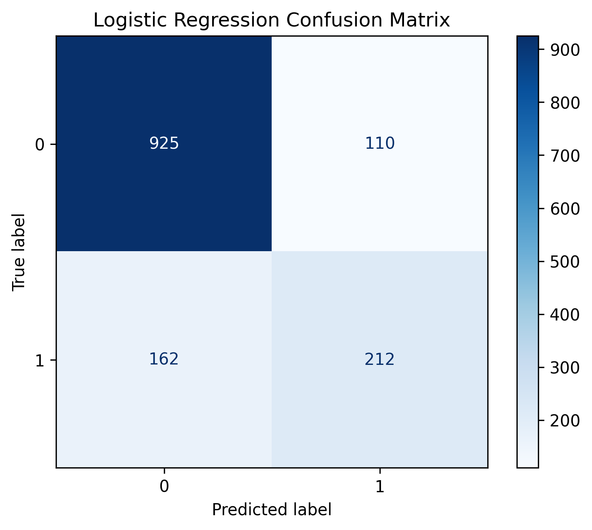
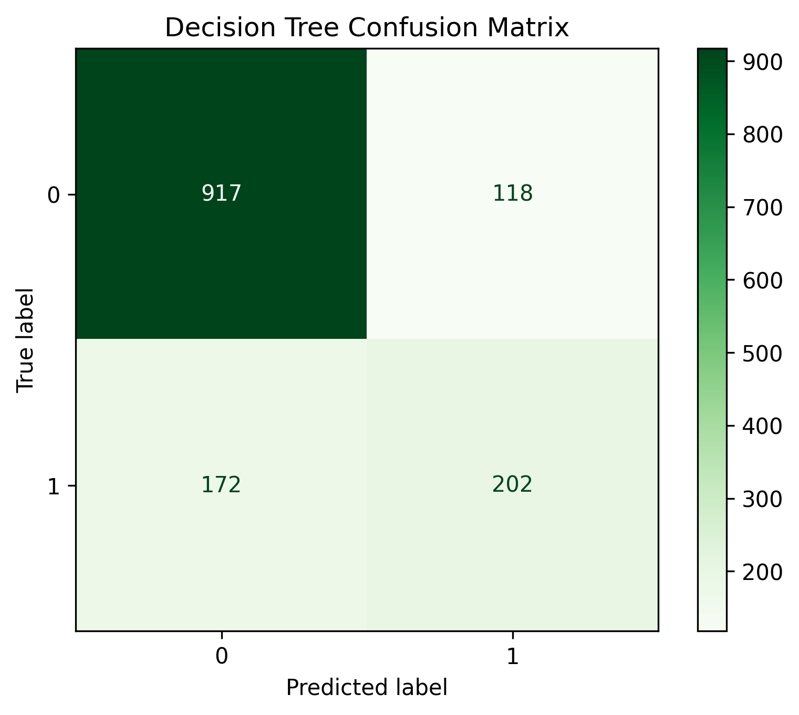
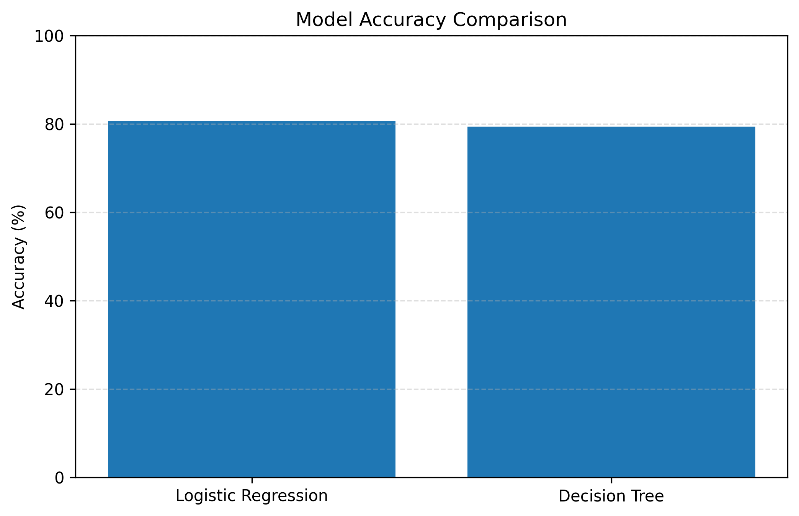

# WEEK-6
GetIntern Week -6
# Week 6: Customer Purchase / Churn Predictor

## Overview
This project trains and evaluates two machine learning classification models using the preprocessed train-test datasets from Week 5. The goal is to predict customer outcomes and compare the performance of Logistic Regression and Decision Tree classifiers.

## Models Implemented
- Logistic Regression – baseline classification model.
- Decision Tree Classifier – tree-based model that learns decision rules.

## Tools & Libraries
- Python
- Pandas
- Matplotlib
- Scikit-learn
- Google Colab

## Model Performance

| Model | Accuracy |
|---|---|
| Logistic Regression | XX.XX% |
| Decision Tree | XX.XX% |

## Evaluation
Both models were evaluated using the unseen test dataset. Accuracy scores and confusion matrices were used to compare their performance.

### Confusion Matrices

#### Logistic Regression

#### Decision Tree

### Accuracy Comparison

## Key Takeaways
- Logistic Regression provides a simple baseline for classification.
- Decision Tree can identify nonlinear relationships and decision rules.
- Accuracy helps compare models, while confusion matrices reveal types of classification errors.
- The better-performing model was **[insert model name]**, based on test accuracy.

## Week 6 Learning Outcomes
- Trained machine learning classification models.
- Generated predictions on unseen test data.
- Evaluated models using accuracy scores.
- Visualized confusion matrices.
- Compared model performance and selected a better-performing classifier.

## Internship
8-Week Practical Data Science & Machine Learning Internship – GetIntern.in
